<p align="center">
  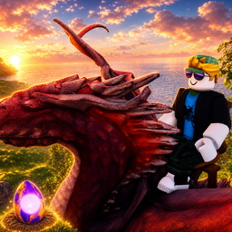
</p>

<h1 align="center">Find, Feed & Fly Dragons</h1>

<p align="center">
  <b>A dragon tycoon for Roblox.</b> Find eggs on a floating archipelago, hatch them in your nest,<br>
  raise every dragon from a tiny hatchling to an elder, then ride it and take to the sky.
</p>

<p align="center">
  
  
  
  
  
</p>

<p align="center">
  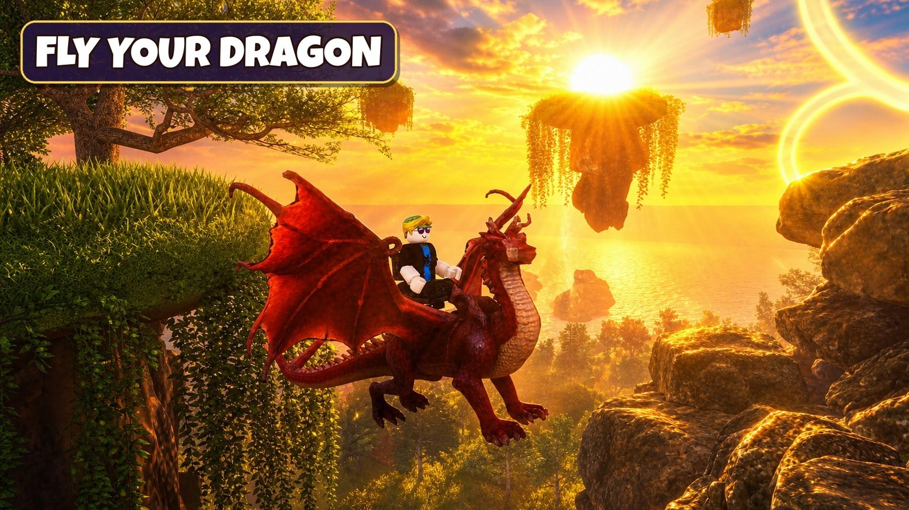
  <br><sub>Store art: an in-game frame from Roblox Studio, painted over.</sub>
</p>

---

## Contents

- [The game in 30 seconds](#the-game-in-30-seconds)
- [Core loop](#core-loop)
- [The hatch](#the-hatch)
- [Dragons](#dragons)
- [The world](#the-world)
- [Why players come back](#why-players-come-back)
- [Monetization](#monetization)
- [Under the hood](#under-the-hood)
- [Build and test](#build-and-test)
- [Repository layout](#repository-layout)
- [Status and roadmap](#status-and-roadmap)
- [Credits and licenses](#credits-and-licenses)

## The game in 30 seconds

- **Eggs are found, not rolled in a menu.** They appear on shared spots across four zones (Meadow, Cliffs, Springs,
  Summit) and respawn every few minutes. The rarity is fixed when you pick the egg up and the odds are shown as "1 in N".
- **Every dragon grows in front of you.** Four stages, each one unlocks something: the Hatchling rides on your shoulder,
  the Juvenile can be ridden, the Adult flies with you, the Elder wears an aura.
- **The nest is your income.** Every dragon in the nest makes coins per second; income climbs with rarity and stage.
- **Six players per server, six nests, no PvP.** Everyone sees everyone else's dragons. Friends speed up each other's
  incubators (Hatch Party) instead of stealing from each other.
- **Realistic look, fairy-tale world.** Future lighting, PBR rocks, painted trees, floating islets, waterfalls, a full
  day and night cycle.

## Core loop

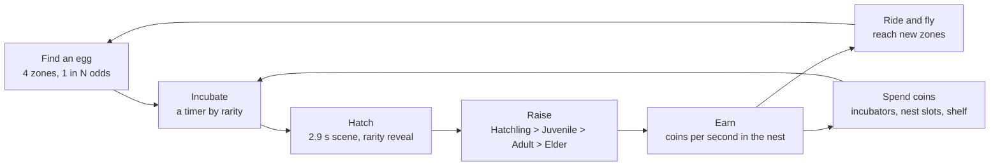

## The hatch

The hatch is the moment the whole loop builds up to, so it gets its own scene. The camera orbits to the bowl, the egg
shakes harder and harder while its core lights up, then it cracks: a flash in the element's color, sparks, flying shell,
and the hatchling pops out with a bounce. Legendary and Mythic hatches keep celebrating for five more seconds (element
sky, a pillar of light, confetti) while the player already has control back. Mythic hatches light up the sky for the
whole server.

<p align="center">
  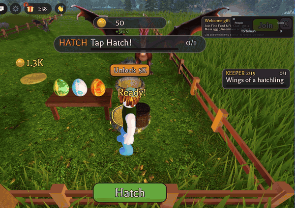
  <br><sub>A Legendary Ember hatch, recorded in Roblox Studio (place version 294).</sub>
</p>

<p align="center">
  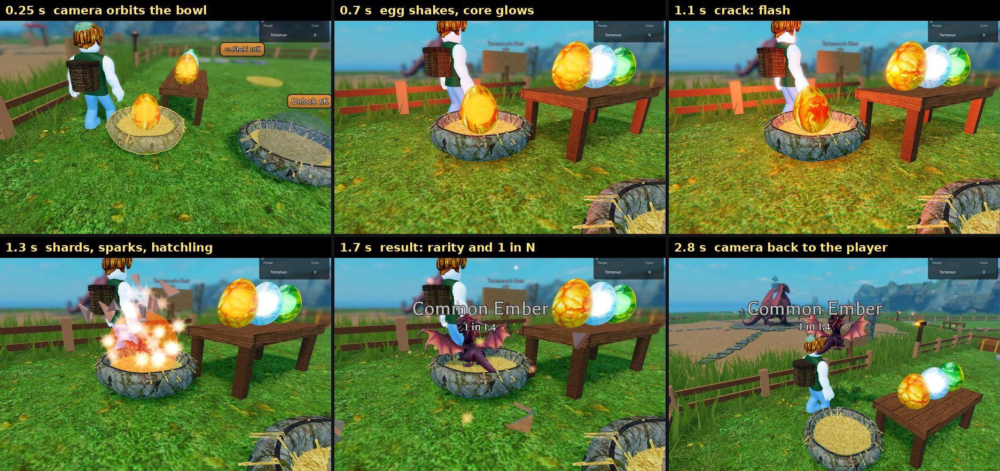
  <br><sub>The full scene, frame by frame. Common and Uncommon hatches after the first two use a short 1.5 s version
  without the camera move.</sub>
</p>

## Dragons

Six elements, four stages, six rarities: 36 entries to collect in the Index, plus Shiny, Big, Huge, Stormborn and
seasonal variants.

<p align="center">
  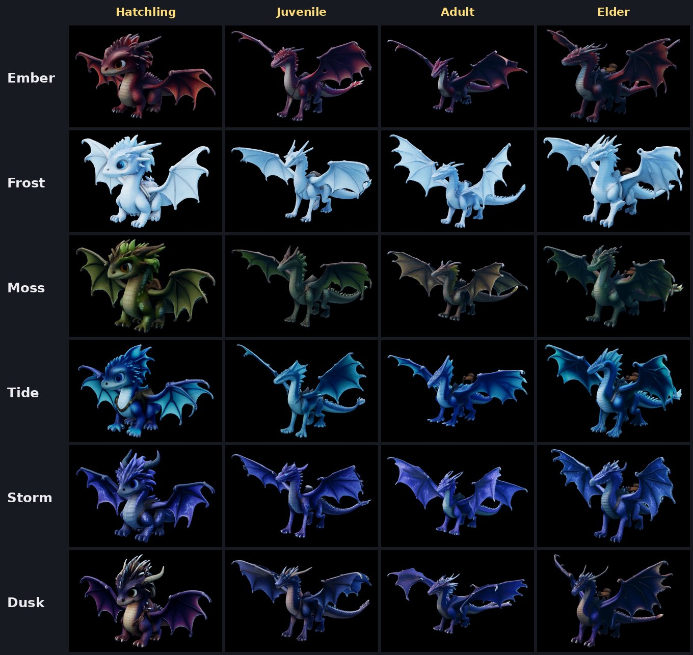
  <br><sub>Portraits rendered from the in-game models.</sub>
</p>

| Rarity | Color | Hatchling income | Incubation |
|---|---|---|---|
| Common |  | 1 coin/s | 3 min |
| Uncommon |  | 4 coins/s | 6 min |
| Rare |  | 16 coins/s | 15 min |
| Epic |  | 80 coins/s | 45 min |
| Legendary |  | 500 coins/s | 2 h |
| Mythic |  | 4,000 coins/s | 6 h |

Stage multipliers: Hatchling x1, Juvenile x6, Adult x30, Elder x100. All numbers live in `src/shared/Config.luau` and
are checked against the balance model by `tests/balance_spec.luau` (the model itself is kept with the design docs
outside this repository).

## The world

<table>
  <tr>
    <td width="33%">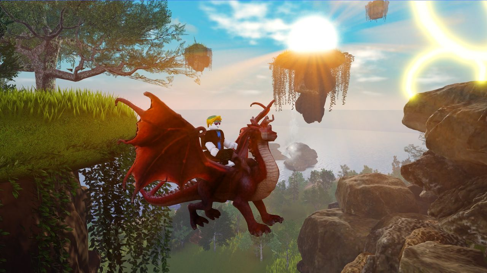</td>
    <td width="33%">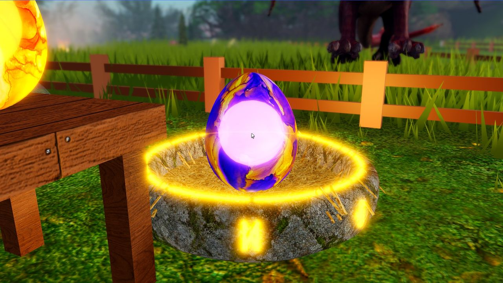</td>
    <td width="33%">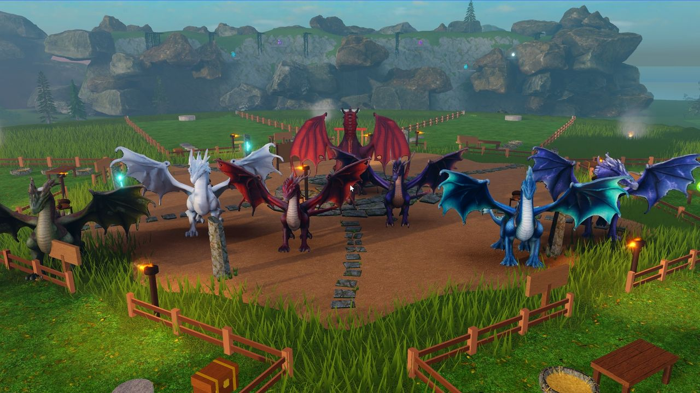</td>
  </tr>
  <tr>
    <td align="center"><sub>Flight past the cliffs and floating islets</sub></td>
    <td align="center"><sub>An egg in the incubator bowl</sub></td>
    <td align="center"><sub>Dragons of all six elements, staged for the store shoot</sub></td>
  </tr>
</table>
<p align="center"><sub>Frames from Roblox Studio, not painted over.</sub></p>

<table>
  <tr>
    <td width="33%">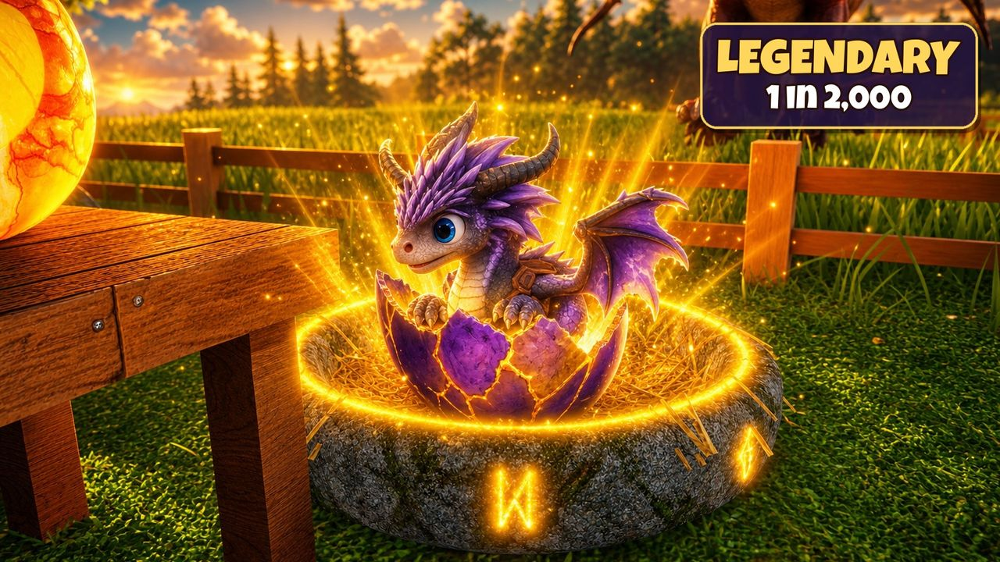</td>
    <td width="33%">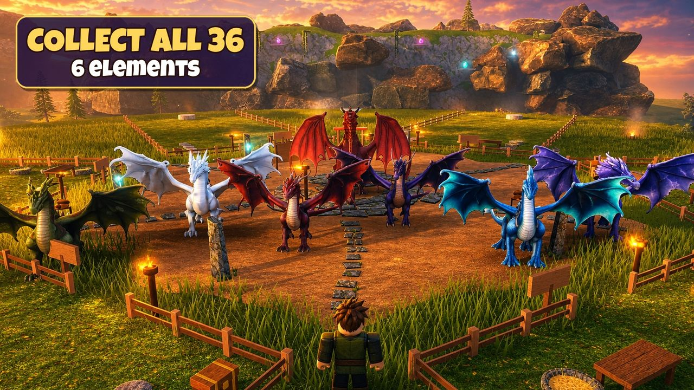</td>
    <td width="33%">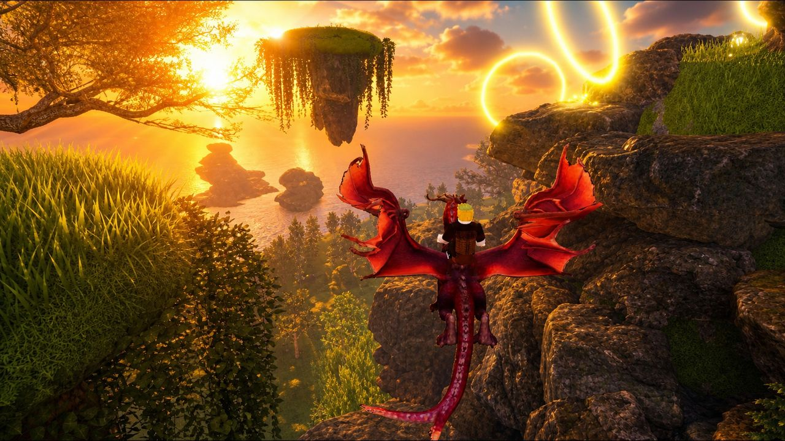</td>
  </tr>
</table>
<p align="center"><sub>Store page art: the same frames, painted over.</sub></p>

## Why players come back

| System | What it gives |
|---|---|
| The Keeper (Old Ash) | 35 quests in chapters, with notes and scrolls hidden around the islands |
| Dailies and gifts | three daily quests with a bonus, playtime gifts, a 7-day calendar that never resets the streak |
| Away income | the nest keeps earning a quarter of its income while you are away (up to 8 hours) |
| Weather | storms (coins x2, Stormborn dragons) and starfall; the Storm Dragon visits the server every 30 minutes |
| Index | 36 entries per element and rarity, with rewards for sets |
| Ascension | 12 steps: reach a dragon goal and pay coins for a permanent income multiplier, a nest tint and a title |
| Social | Hatch Party, invites, Top nests board, server-wide announcements for Epic and better |
| Season 1 | 28 days from the launch, with a seasonal Legendary |

Live ops are built into the config and switch on by date, no new release needed:

| Update | Date (2026) | Content |
|---|---|---|
| Aurora | Nov 8 | aurora weather, Glacier Frost dragons, Keeper tales 16-20, the AURORA code |
| Cinder | Nov 15 | an Ember dragon of the week with its own color preset, Keeper tales 21-25 |
| Pearl Tide | Nov 22 | pearl dragons at the springs, Storm Dragon chapter 2, a new flight trail |
| Nightfall | Nov 29 | a Dusk dragon of the week, the Night Sky nest skin, the last week of Season 1 |

## Monetization

Coins are the only in-game currency, and there are no coin packs. Robux buy time, convenience and looks:

- **7 game passes:** VIP, x2 Coins, Auto Collect, Fast Incubator, three extra nest slots.
- **50 developer products:** Hatch Now and Grow Now (priced by the time left), treats, timed boosts, "nest income for
  N hours", the dragon of the week, flight trails, a color preset, nest skins, a nest bundle, the Starter Pack, and a
  Gift version of most items for another player.
- **Under review:** the Starter Pack currently gives two eggs of random rarity (Rare or better) where Roblox allows paid random items
  (odds shown before purchase) and two Rare eggs elsewhere.

The full product list and prices are in `monetize.py` (`CATALOG`) and `src/shared/Core/Shop.luau`; the Roblox, EU, UK,
US and Belgian rules are covered by the compliance section of the design spec, kept outside this repository.

## Under the hood

| Area | Details |
|---|---|
| Code | ~32,000 lines of Luau in 99 modules, all `--!strict` |
| Server | 24 services: world builder, nests, eggs, incubation, movement and flight, quests, rewards, shop (ProcessReceipt), weather, live ops, analytics, ProfileStore saves |
| Client | 38 controllers: HUD, hatch scene, flight, dragon life (wings, breathing, play), menus, shop, Index, quests, LOD and declutter |
| Shared core | 26 pure modules (economy, eggs, odds, growth, quests, rewards, shop, weather, live ops, hatch scene) with no Roblox API, tested in the luau CLI |
| Build | `build.py` turns `src/` into a place file without Studio or Rojo; `publish.py` ships it through Roblox Open Cloud |
| Verification | every visual change is checked by eye in Roblox Studio on a cloud Windows machine (screenshots and screen recordings), then published |

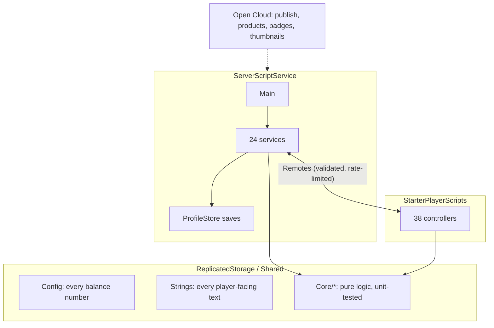

Tests (`tests/`): the core spec runs 112,394 checks, plus balance, shop (4,077), content and live ops (497), social,
weather, looks and hatch specs; `inspect_place.luau` checks the built place file; `tests/cloud/*` run against the
published place through Luau Execution.

## Build and test

Requirements: Python 3, the [luau](https://github.com/luau-lang/luau) CLI, [Lune](https://github.com/lune-org/lune) 0.10.
Run from the repository root:

```bash
luau tests/run.luau                                   # core and layout
luau tests/balance_spec.luau                          # Config matches the balance model
luau tests/shop_spec.luau                             # shop catalog, ids, gifts
luau tests/hatch_spec.luau                            # hatch scene timings
luau tests/raid_spec.luau                             # raid config, day-one rules, guard speed
luau tests/glowegg_spec.luau                          # golden nest config, pedestal timer, Hatch Now
python3 build.py                                      # build into build/place.rbxlx
lune run tests/inspect_place.luau build/place.rbxlx   # inspect the built place
python3 publish.py                                    # publish (needs the Open Cloud key, see below)
```

The Open Cloud key is read from the file named in `ROBLOX_OPENCLOUD_KEY_FILE` (default `.roblox_opencloud`, ignored by git).
The scripts never print it.

## Repository layout

```
src/
  first/       ReplicatedFirst: loading screen with a 3D hatchling, first client script
  shared/      Config, Content, Strings, Remotes, Validate, ShopIds and DecorAssets (generated), Core/*
  server/      Main + Services/*
  client/      Controllers/*
vendor/        ProfileStore (Apache-2.0)
tests/         specs (luau CLI), place inspection (Lune), cloud checks
tools/         texture, tree, icon and mesh generation; asset upload
assets_src/    asset sources: terrain textures, painted trees, plaza and bowl meshes, portraits, UI, fonts
assets*.json   ids of assets already uploaded to Roblox
media/         images for this README
build.py  publish.py  monetize.py  cloud_test.py
```

The design spec, the balance model, the session log and the research notes are kept outside this repository. Everything
here (code, comments, tests, tools and in-game text) is in English.

## Status and roadmap

As of October 17, 2026 the game runs in a private Roblox place (version 294).

- **Done:** the core loop (find, hatch, raise, earn, ride, fly), the world and archipelago, nests and incubators,
  the shop, quests and Keeper chapters, dailies and gifts, away income, social layer, weather and the Storm Dragon,
  the Index, Ascension, live ops with updates 1-4, the hatch scene, the store icon and thumbnails, the group.
- **Before launch:** the full new-player run on a phone-sized screen, client memory budget, the remaining badges,
  the Starter Pack decision, the content rating questionnaire, a final review.
- **Launch:** planned for November 6, 2026, together with Season 1.

Live task status and the session log are kept with the design docs outside this repository.

## Development rules

- All in-game text is English only and lives only in `src/shared/Strings.luau`.
- All balance numbers live only in `src/shared/Config.luau`.
- Learn from the genre leaders, never copy them: code, world, dragons and text are our own.
- The server validates everything that comes from the client.

## Not in this repository

- **Keys** (Open Cloud and any other secrets).
- **Build output** (`build/`, `*.rbxl*`): rebuilt from `src/` with one command.
- **Videos, logs, backups and test-run artifacts.**
- **Unused leftovers** of the first prototype and one-off experiments: only work that passed its checks is committed.

## Credits and licenses

- [ProfileStore](https://github.com/MadStudioRoblox/ProfileStore) by MadStudioRoblox, Apache-2.0: `vendor/ProfileStore.LICENSE`.
- [Kenney](https://kenney.nl) Nature Kit, CC0: `assets_src/kenney_nature/License.txt`.
- [Poly Haven](https://polyhaven.com) rocks and plants, CC0.
- Fonts: Fredoka (SIL OFL 1.1), Luckiest Guy (Apache 2.0): `assets_src/fonts/`.

Everything else (code, world, dragons, texts, art direction) was made for this game. Some textures, dragon models and
the store art were made with generative AI tools and then edited and checked in the game.

[MIT License](./LICENSE)
